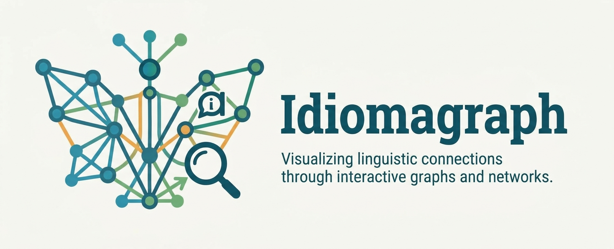
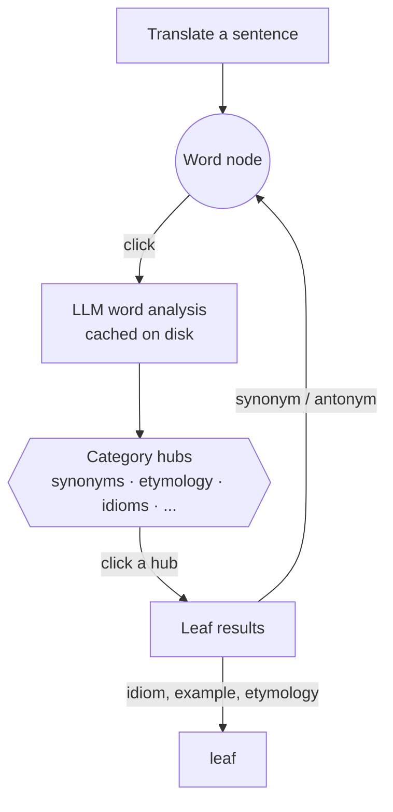

<div align="center">



<h3>Translate with an LLM, then explore how words connect across languages.</h3>

[](https://github.com/seanglynn/idiomagraph/actions/workflows/ci.yml)


[Features](#-features) ·
[Quick start](#-quick-start) ·
[Using the app](#-using-the-app) ·
[How it works](#-how-it-works) ·
[Configuration](#-configuration) ·
[Development](#-development) ·
[Troubleshooting](#-troubleshooting)

<!-- Add a screenshot or GIF of the app at docs/assets/screenshot.png -->


</div>

---

## 💡 What is Idiomagraph?

Idiomagraph is an interactive language-learning companion built around a graph of words, phrases, and their connections across languages. Explore translations, cognates, shared roots, false friends, grammar, idioms, and pronunciation all in one visual space.

**Why?** Languages are easier to understand when you can see how they connect. Idiomagraph turns those connections into an explorable graph, helping you discover relationships, follow your curiosity, and build a deeper understanding of language.

## ✨ Features

| | Feature | What it does |
|---|---|---|
| 🌐 | **Multi-language translation** | Translate into several target languages at once. Requests run concurrently, so three languages take about as long as one. |
| 🕸️ | **Semantic Graph** | Words become nodes, colored by language and outlined by part of speech. Edges show **translations** (word alignments reported by the LLM) and **cognates** (string-similarity heuristics). Both are kept when a pair matches both. |
| 🔍 | **Click-to-explore** | Click a word to run a structured LLM word analysis. Categories such as synonyms, etymology, examples and idioms expand as new nodes inside the graph. |
| 📈 | **Co-occurrence Network** | Shows which words appear near each other, per language. You can tune the window size, minimum frequency and part-of-speech filter. Includes network stats and the most central words. |
| 📚 | **Word analysis panel** | Tabbed detail view: *Origins, Meaning, Grammar, Usage, Idioms, Tips, Sound*. Results are cached on disk, so asking about the same word again is instant. |
| 🔊 | **Text-to-speech** | Listen to any translation through Google Text-to-Speech. |
| 🗂️ | **Graph history** | Every graph is saved locally. You can search, reload or delete it from the sidebar. |
| 🤖 | **Choice of LLM** | Use **Ollama** (local and free), **OpenAI**, or **Anthropic Claude**, and switch from the sidebar at runtime. |
| 🐳 | **One-command Docker** | `make docker-start` brings up the app plus an Ollama server. No API keys needed. |

## 🚀 Quick start

**Prerequisites**:
- [Docker](https://docs.docker.com/get-docker/) with Compose, **or** [uv](https://docs.astral.sh/uv/) and Python 3.12
- An LLM backend: either [Ollama](https://ollama.com/), which the Docker setup includes, or an OpenAI / Anthropic API key

### Option A: Docker + Ollama (no API keys)

```bash
git clone https://github.com/seanglynn/idiomagraph.git
cd idiomagraph
cp env.example .env
make docker-start
```

Open **http://localhost:8503**. The first translation is slow because the
configured Ollama model (`llama3.2:latest` by default) is pulled into
`./ollama-models/`. Later runs reuse that download.

### Option B: Docker + Claude

```bash
cp env.example .env
```

Edit `.env` and set the provider and key:

```dotenv
LLM_PROVIDER=anthropic
ANTHROPIC_API_KEY=sk-ant-...
```

```bash
make docker-start
```

Open **http://localhost:8503**. The Ollama container still starts, but it isn't used.

### Option C: Docker + OpenAI

```bash
cp env.example .env
```

Edit `.env` and set the provider and key:

```dotenv
LLM_PROVIDER=openai
OPENAI_API_KEY=sk-...
```

```bash
make docker-start
```

Open **http://localhost:8503**. The Ollama container still starts, but it isn't used.

> [!TIP]
> Working on the code? See [Development mode](#development-mode-run-locally-with-uv)
> to run the app locally with uv and auto-reload.

## 🧭 Using the app

1. **Choose languages.** Open the sidebar (`>` at the top left). Under **Language
   Settings**, pick a source language and one or more target languages.
2. **Translate.** Type text into the **💬 Translation** box and click
   **🔄 Translate**. Each translation appears with a 🔊 button that reads it aloud.
3. **Explore the Semantic Graph.** In the **📊 Semantic Graph** tab:
   - Click a node to see its details in the side panel.
   - Click **🔍 Analyze this word** to fetch a full analysis. Its categories appear
     as hub nodes around the word. Click a hub to expand or collapse it.
   - Use **Graph Options** to merge the language graphs, set a minimum
     relationship strength, or filter by edge type. Open **📊 Graph Legend** for a key to the colors.
4. **Switch to the Co-occurrence Network.** In the **📈 Co-occurrence Network**
   tab, pick a language to see which words cluster together. Tune the window
   size, frequency and POS filter under **📊 Graph Options** in the sidebar.
5. **Come back later.** Saved graphs live under **📈 Graph History** in the
   sidebar. You can search, reload or delete them there.

> [!NOTE]
> Want a sentence to try? Drop *"Take me to the moon and let me play among the stars"* into two target languages
> gives a small, readable graph with clear translation and cognate links.

## 🔬 How it works



1. **Translation.** Each target language gets one concurrent LLM call. The
   model returns JSON with the translation *and* a word-level alignment
   (`source_word → target_word`). This is validated by the `Translation`
   schema in `idiomagraph/models/llm.py`, the same way for every provider.
2. **NLP.** spaCy and textacy split the texts into sentences and tag parts of
   speech.
3. **Semantic graph.** Aligned word pairs become **translation** edges. An
   independent string-similarity check adds **cognate** edges. Both signals are
   kept side by side in a `networkx.MultiDiGraph`, so neither overwrites the other.
4. **Rendering.** The graph is styled and handed to ECharts. A click on any node or
   edge round-trips to Python as a typed, validated payload.
5. **Word analysis.** Analyzing a word asks the LLM for a structured
   `WordAnalysis`: meaning, usage, grammar, pronunciation and learner notes. The
   result is cached on disk and merged into the graph as expandable category
   nodes.

Deeper reading:
- [`docs/LANGUAGE_GRAPHS.md`](docs/LANGUAGE_GRAPHS.md) explains how to read both graph types.
- [`docs/graph_data_model.md`](docs/graph_data_model.md) covers the typed graph data model, with a class diagram.

<details>
<summary><b>📁 Project structure</b></summary>

```text
idiomagraph/    # The app: config, Streamlit UI, typed models, and utility modules
tests/          # pytest suite, including Streamlit AppTest UI tests
docs/           # In-depth docs and assets
docker/         # Dockerfile + entrypoint
.github/        # CI workflow
.streamlit/     # Local Streamlit server config
```

See also [`idiomagraph/utils/README.md`](idiomagraph/utils/README.md) for a per-module API overview.

</details>

## 🔧 Configuration

All settings are read from environment variables or a `.env` file in the repo
root. Start from the documented template:

```bash
cp env.example .env
```

The one choice that matters is **`LLM_PROVIDER`**. Everything else has a sensible
default. Provider, model and API keys can also be changed from the sidebar's
**⚙️ LLM Settings** while the app is running.

### Choosing an LLM provider

| | Ollama | OpenAI | Anthropic Claude |
|---|---|---|---|
| `LLM_PROVIDER` | `ollama` *(default)* | `openai` | `anthropic` (or `claude`) |
| Runs | Locally / in Docker | Hosted | Hosted |
| Cost | Free | Paid API | Paid API |
| Needs | A running Ollama server | `OPENAI_API_KEY` | `ANTHROPIC_API_KEY` |
| Default model | `llama3.2:latest` | `gpt-3.5-turbo` | `claude-haiku-4-5` |
| Model list in sidebar | Models installed on the Ollama server | Live from the API (falls back to `OPENAI_MODELS`) | Live from the API (falls back to `ANTHROPIC_MODELS`) |

> [!NOTE]
> **Claude specifics:** `claude-haiku-4-5` is the fastest and cheapest choice.
> Switch to `claude-opus-5` for higher-quality word analyses. Claude models don't
> accept `temperature`, so response depth is controlled by `ANTHROPIC_EFFORT`.
> That setting only applies to models that support it (see
> `ANTHROPIC_MODEL_CAPABILITIES` in [`idiomagraph/config.py`](idiomagraph/config.py)).

### Reference

Defaults below are the built-in values from `idiomagraph/config.py`.

#### General

| Variable | Default | Description |
|---|---|---|
| `LLM_PROVIDER` | `ollama` | `ollama`, `openai` or `anthropic` (`claude` is accepted as an alias) |
| `LOG_LEVEL` | `INFO` | `DEBUG`, `INFO`, `WARNING`, `ERROR`, `CRITICAL` |

#### Ollama

| Variable | Default | Description |
|---|---|---|
| `OLLAMA_HOST` | `http://localhost:11434` | Ollama server URL. Use `http://ollama:11434` in Docker, which is the value in `env.example`. |
| `DEFAULT_MODEL` | `llama3.2:latest` | Model to use. It's pulled automatically if missing. |

#### OpenAI

| Variable | Default | Description |
|---|---|---|
| `OPENAI_API_KEY` | — | Required for OpenAI. Can also be entered in the sidebar. |
| `OPENAI_ORGANIZATION` | — | Optional organization ID |
| `OPENAI_MODEL` | `gpt-3.5-turbo` | Model to use |
| `OPENAI_MODELS` | `gpt-3.5-turbo,gpt-4,gpt-4-turbo` | Fallback dropdown list if the live model list can't be fetched |
| `OPENAI_TEMPERATURE` | `0.7` | `0.0`–`2.0`. Ignored by models that only accept the default. |
| `OPENAI_MAX_TOKENS` | `1024` | `1`–`4096` |

#### Anthropic (Claude)

| Variable | Default | Description |
|---|---|---|
| `ANTHROPIC_API_KEY` | — | Required for Claude. Can also be entered in the sidebar. |
| `ANTHROPIC_MODEL` | `claude-haiku-4-5` | Model to use |
| `ANTHROPIC_MODELS` | `claude-haiku-4-5,claude-sonnet-5,claude-opus-5` | Fallback dropdown list if the live model list can't be fetched |
| `ANTHROPIC_MAX_TOKENS` | `8192` | `1`–`64000` |
| `ANTHROPIC_EFFORT` | `low` | `low`, `medium`, `high`, `xhigh`, `max`. Ignored for models without effort support. |

#### Languages & graphs

| Variable | Default | Description |
|---|---|---|
| `SUPPORTED_LANGUAGES` | `en,es,ca` | Languages offered in the sidebar. Each one must exist in `LANGUAGE_MAP` (see [Supported languages](#-supported-languages)). |
| `DEFAULT_SOURCE_LANGUAGE` | `en` | Preselected source language |
| `DEFAULT_TARGET_LANGUAGES` | `es,ca` | Preselected target languages |
| `DEFAULT_WINDOW_SIZE` | `2` | Co-occurrence window, in words |
| `DEFAULT_MIN_FREQUENCY` | `1` | Minimum co-occurrence count for an edge |
| `DEFAULT_POS_FILTER` | `NOUN,VERB,ADJ` | Parts of speech kept in the co-occurrence network |

<details>
<summary><b>Streamlit server settings</b></summary>

Streamlit reads these as environment variables when it starts. Under Docker,
Compose injects `.env` into the container, so they apply there. When you run
locally with `make run-graph-dev`, the server settings come from
[`.streamlit/config.toml`](.streamlit/config.toml) and command-line flags instead.

| Variable | `env.example` value | Description |
|---|---|---|
| `STREAMLIT_SERVER_PORT` | `8503` | Port the app listens on. It's also the host port mapped by Compose. |
| `STREAMLIT_SERVER_ADDRESS` | `0.0.0.0` | Bind address. `0.0.0.0` is needed inside a container. |
| `STREAMLIT_SERVER_HEADLESS` | `true` | Don't try to open a browser on start |
| `STREAMLIT_SERVER_ENABLECORS` | `false` | CORS protection |
| `STREAMLIT_SERVER_ENABLEXSRFPROTECTION` | `true` | XSRF protection |
| `STREAMLIT_BROWSER_GATHER_USAGE_STATS` | `false` | Streamlit telemetry |
| `STREAMLIT_THEME_BASE` | `dark` | `dark` or `light` |
| `STREAMLIT_CLIENT_TOOLBAR_MODE` | `minimal` | Toolbar shown in the top-right menu |
| `STREAMLIT_CLIENT_SHOW_ERROR_DETAILS` | `true` | Show tracebacks in the UI |

</details>

<details>
<summary><b>🖥️ Running Ollama on an NVIDIA GPU</b></summary>

Uncomment the `deploy:` block under the `ollama` service in
[`docker-compose.yml`](docker-compose.yml). This requires the
[NVIDIA Container Toolkit](https://docs.nvidia.com/datacenter/cloud-native/container-toolkit/latest/install-guide.html)
on the host.

</details>

## 🌍 Supported languages

These languages are currently configured:

| Code | Language | spaCy model | Text-to-speech voice |
|---|---|---|---|
| `en` | 🇬🇧 English | `en_core_web_sm` | English |
| `es` | 🇪🇸 Spanish | `es_core_news_sm` | Spanish |
| `ca` | 🏴󠁥󠁳󠁣󠁴󠁿 Catalan | `ca_core_news_sm` | Spanish |

<details>
<summary><b>Adding a language</b></summary>

All of the following live in [`idiomagraph/config.py`](idiomagraph/config.py) unless noted:

1. Add an entry to `LANGUAGE_MAP` (name, flag, TTS code).
2. Add its spaCy model to `LANG_MODELS`. Pick one from [spacy.io/models](https://spacy.io/models).
3. Add it to `TTS_LANG_CODES`, `TTS_LANGUAGE_NAMES`, `LANGUAGE_MARKERS` and `GROUP_COLORS`.
4. Add the code to `SUPPORTED_LANGUAGES` in your `.env`.
5. For Docker, add a `python -m spacy download <model>` line to
   [`docker/Dockerfile`](docker/Dockerfile), so the image ships with it.

</details>

## 💾 Data & persistence

Everything Idiomagraph stores stays on your machine, in the repo directory. All of
it is git-ignored:

| Path | Contents |
|---|---|
| `graph_storage/` | Saved graphs shown in **📈 Graph History** |
| `word_analysis_cache/` | Cached LLM word analyses |
| `logs/` | Application logs |
| `ollama-models/` | Models downloaded by the Docker Ollama container |

To wipe saved graphs, use **🗑️ Clear All Data** in the sidebar's Graph History.
For the other folders, delete them by hand.

## 🧪 Development

### Development mode: run locally with uv

```bash
cp env.example .env
```

In `.env`, point the app at your local services:

```dotenv
OLLAMA_HOST=http://localhost:11434   # env.example ships the Docker value
# ...or use a hosted provider instead:
# LLM_PROVIDER=anthropic
# ANTHROPIC_API_KEY=sk-ant-...
```

```bash
make install         # uv sync
make run-graph-dev   # streamlit with auto-reload
```

Open **http://localhost:8503**. On the first run, spaCy downloads the language
models it needs. This takes a minute, and only happens once.

> [!TIP]
> Using Ollama locally? Start it first with `ollama serve`. Idiomagraph pulls the
> configured model for you if it isn't installed yet.

### Tests and lint

```bash
make install   # install all dependencies with uv
make test      # pytest
make lint      # flake8 + black --check
make format    # black
```

CI runs the tests and lint on every push and pull request. No API keys or
downloads are needed: every provider SDK is mocked, and spaCy is stubbed with a
blank pipeline.

<details>
<summary><b>All <code>make</code> targets</b></summary>

| Target | Description |
|---|---|
| `make install` | `uv sync` |
| `make run-graph-dev` | Run locally with auto-reload on save |
| `make run-graph` | Run locally via `python -m idiomagraph.streamlit.app` |
| `make test` | Run the pytest suite |
| `make lint` | flake8 + black formatting check |
| `make format` | Format with black |
| `make docker-start` | Build and run in the foreground |
| `make docker-start-detached` | Build and run in the background |
| `make docker-down` | Stop the containers |
| `make docker-logs` | Follow the container logs |
| `make docker-shell` | Shell into the app container |
| `make ollama-shell` | Shell into the Ollama container |

</details>

## 🩺 Troubleshooting

<details>
<summary><b>The first translation takes ages (Ollama)</b></summary>

The configured model is downloaded on first use, which is about 2 GB for
`llama3.2`. Watch progress with `make docker-logs`. Later starts reuse
`./ollama-models/`.

</details>

<details>
<summary><b>Docker can't reach Ollama</b></summary>

Confirm the Ollama container is up (`docker ps`). Inside Docker, `OLLAMA_HOST`
must be `http://ollama:11434`, not `localhost`. The Ollama container doesn't
publish port 11434 to the host, so it won't clash with a native Ollama install.
See the comment in [`docker-compose.yml`](docker-compose.yml) if you need to
reach it from the host.

</details>

<details>
<summary><b>"API key is not set" / the model shows as unavailable</b></summary>

Set `OPENAI_API_KEY` or `ANTHROPIC_API_KEY` in `.env` and restart, or paste the
key into **⚙️ LLM Settings** in the sidebar.

</details>

<details>
<summary><b>The first local run pauses while loading spaCy</b></summary>

Outside Docker, missing spaCy models are downloaded on first use. To fetch them
up front:

```bash
uv run python -m spacy download en_core_web_sm
uv run python -m spacy download es_core_news_sm
uv run python -m spacy download ca_core_news_sm
```

</details>

<details>
<summary><b>Files under <code>logs/</code> or <code>graph_storage/</code> are owned by root</b></summary>

The Docker image runs as a non-root user matching UID `1000` by default. If your
host user has a different UID, rebuild with:

```bash
docker compose build --build-arg UID=$(id -u) --build-arg GID=$(id -g)
```

</details>

<details>
<summary><b>Anything else</b></summary>

- Tick **Show Debug Logs** under **🐛 Debug** in the sidebar to see live logs in the app.
- Use `make docker-logs`.
- Use `make docker-shell` / `make ollama-shell` to look around inside a container.

</details>

## 🔒 Security note

In Docker, the app binds to `0.0.0.0` *inside* the container. Only the mapped
port (`8503`) is reachable from your host, and the Ollama container isn't
published at all.

When you run locally, Streamlit listens on all network interfaces by default. To
keep it on your machine only, run:

```bash
uv run streamlit run idiomagraph/streamlit/app.py --server.address=localhost
```

## 🙏 Built with

[Streamlit](https://streamlit.io/) ·
[spaCy](https://spacy.io/) ·
[textacy](https://textacy.readthedocs.io/) ·
[NetworkX](https://networkx.org/) ·
[Apache ECharts](https://echarts.apache.org/) via
[streamlit-echarts](https://github.com/andfanilo/streamlit-echarts) ·
[Pydantic](https://docs.pydantic.dev/) ·
[gTTS](https://gtts.readthedocs.io/) ·
[Ollama](https://ollama.com/) ·
[OpenAI](https://platform.openai.com/) ·
[Anthropic Claude](https://www.anthropic.com/claude)
